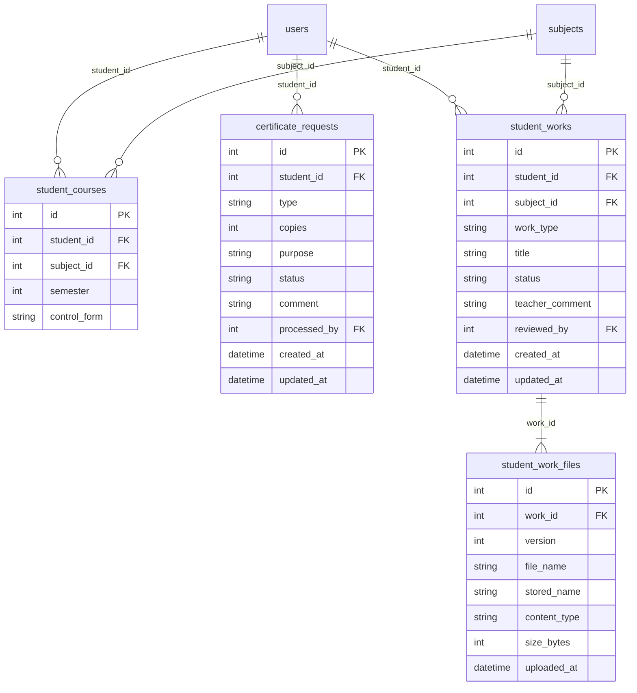

# Техническое задание: Backend модуля «Кабинет студента» (Student Portal)

## 1. Назначение модуля

Модуль «Кабинет студента» — это личная страница студента на сайте колледжа. Здесь он в одном месте находит всё, что нужно для учёбы, и ему не приходится ходить за этим к преподавателям или в деканат.

Что студент может делать:

- войти в кабинет по своему логину и паролю;
- посмотреть расписание на неделю;
- узнать свои оценки по каждому предмету и увидеть, где есть задолженность;
- проверить, сколько занятий он посетил, а сколько пропустил;
- заказать справку в деканате и следить, готова она или нет;
- загрузить свою работу (курсовую, лабораторную) и посмотреть, приняли её или нужно доработать.

**Откуда берутся данные.** Оценки, расписание и посещаемость вносят преподаватели и администраторы через другие модули (электронный журнал, расписание). Кабинет эти данные только показывает. Самому кабинету принадлежат три вещи: список курсов студента, заявки на справки и загруженные работы.

**Кто что видит.** Каждый студент видит только свои данные. Чужие оценки, пропуски и заявки ему недоступны.

Backend модуля предоставляет REST API с префиксом `/api/v1/student_portal`: выдаёт токен при входе, собирает для студента данные других модулей и ведёт собственные таблицы кабинета. Почти все эндпоинты доступны только роли `student`. Несколько служебных эндпоинтов нужны администратору (деканату) и преподавателю, чтобы обработать заявку на справку и проверить загруженную работу.

## 2. Функциональные требования

### 2.1. Основные функции

- **Вход в кабинет:** проверка email и пароля средствами `core/`, выдача JWT-токена. Войти может только активный (не заблокированный и не удалённый) пользователь с ролью `student`.
- **Профиль:** ФИО, email, учебная группа и текущий семестр — для шапки кабинета.
- **Главная страница:** занятия на сегодня и ближайшее занятие, средний балл и число задолженностей за текущий семестр, процент посещаемости, число работ на доработке и готовых справок, последние объявления группы.
- **Расписание:** занятия группы студента за выбранный период (по умолчанию — текущая неделя) с фильтром по типу занятия.
- **Курсы и успеваемость (зачётка):** дисциплины студента по семестрам с формой контроля и часами; текущие и итоговые оценки по каждой дисциплине, средний балл, статус дисциплины: «сдано», «задолженность» или «в процессе».
- **Посещаемость:** сводка по дисциплинам за семестр (сколько занятий посещено, сколько пропущено, опоздания) и список отметок с фильтрами.
- **Объявления:** объявления преподавателей для группы студента (создаются в модуле Teacher Portal).
- **Справки:** каталог видов справок, заказ справки, список своих заявок со статусами, отмена заявки, пока её не взяли в работу. Администратор (деканат) меняет статус заявки через служебный эндпоинт.
- **Учебные работы:** загрузка файла работы (PDF или DOCX, до 20 МБ) по своей дисциплине, загрузка исправленной версии, история версий, скачивание файла. Преподаватель дисциплины видит работы студентов своих групп и выставляет результат проверки («принята» или «на доработку») через служебные эндпоинты.

### 2.2. Пользовательские сценарии

**Сценарий 1: Вход в кабинет**

1. Студент открывает страницу входа и вводит email и пароль.
2. Backend находит пользователя по email, проверяет пароль по хэшу средствами `core/auth.py`, а также роль `student`, флаг `is_active` и отсутствие отметки об удалении.
3. Клиент получает токен и во всех следующих запросах передаёт его в заголовке `Authorization: Bearer <token>`. При неверном пароле приходит `401`, заблокированному пользователю — `403`.

**Сценарий 2: Просмотр расписания на неделю**

1. Студент открывает раздел «Расписание»; frontend запрашивает текущую неделю или выбранный период.
2. Backend определяет группу студента по токену и читает занятия этой группы из данных модуля Schedule.
3. Клиент получает занятия, отсортированные по дате и времени начала, с дисциплиной, преподавателем, аудиторией и типом занятия.

**Сценарий 3: Просмотр зачётки и задолженностей**

1. Студент открывает раздел «Успеваемость» и выбирает семестр (по умолчанию — текущий).
2. Backend берёт дисциплины студента за этот семестр из `student_courses` и для каждой читает оценки из модуля Gradebook, считает средний балл и статус дисциплины.
3. Клиент получает таблицу дисциплин. Дисциплины с неудовлетворительной итоговой оценкой помечены как задолженность и учтены в поле `debts_count`.

**Сценарий 4: Заказ справки и отслеживание статуса**

1. Студент выбирает в каталоге «Справка об обучении», указывает количество экземпляров и куда нужна справка.
2. Backend проверяет данные и создаёт запись в `certificate_requests` со статусом `new`.
3. Сотрудник деканата (роль `admin`) берёт заявку в работу, а затем отмечает её готовой: статус меняется на `in_progress`, затем на `ready`.
4. Студент видит актуальный статус в списке «Мои заявки». Пока заявка в статусе `new`, студент может её отменить.

**Сценарий 5: Загрузка работы и исправленной версии**

1. Студент выбирает дисциплину и тип работы, вводит название и прикладывает файл PDF.
2. Backend проверяет, что дисциплина есть среди курсов студента, а также тип и размер файла. Файл сохраняется в хранилище под сгенерированным именем, в `student_works` создаётся работа со статусом `submitted`, в `student_work_files` — версия 1.
3. Преподаватель дисциплины скачивает файл и отправляет работу на доработку с комментарием — статус меняется на `revision`.
4. Студент видит комментарий и загружает исправленный файл: появляется версия 2, статус снова `submitted`. Когда преподаватель принимает работу, статус становится `accepted`, и загружать новые версии уже нельзя.

## 3. Нефункциональные требования

- **Производительность:** ответ на любой запрос, кроме загрузки и скачивания файлов, — не более 1 секунды в локальном окружении. Списки заявок, работ, объявлений и отметок посещаемости отдаются с пагинацией (страница — до 100 элементов). Период в запросе расписания — не более 184 дней (один семестр). Размер загружаемого файла — не более 20 МБ.
- **Безопасность:**
  - Все эндпоинты, кроме `POST /auth/login`, требуют заголовок `Authorization: Bearer <token>` (иначе `401`) и подходящую роль (иначе `403`).
  - Студент получает только свои данные: id студента берётся из токена и не передаётся ни в пути, ни в параметрах. На запрос чужой заявки или работы приходит `404`, как будто её нет.
  - Заблокированный (`is_active = false`) или удалённый (заполнено `deleted_at`) пользователь не может войти, а выданный ему ранее токен перестаёт действовать (`401`).
  - Пароли хранятся только в виде хэша (`core/auth.py`) и никогда не возвращаются в ответах.
  - Загружаемые файлы: проверяются расширение (`.pdf`, `.docx`) и размер. Файл сохраняется под сгенерированным именем вне папки `frontend/`, исходное имя хранится только в БД. Файлы отдаются только через API с проверкой прав.
  - Все входные данные валидируются Pydantic-схемами.
- **Совместимость:**
  - Модуль использует общие компоненты `core/` — конфигурацию, подключение к БД (`get_db`, `Base`), модель `User`, хэширование паролей и JWT (`core/auth.py`) — и не дублирует их.
  - Структура кода повторяет `docs/examples/example_module/` (`models.py`, `schemas.py`, `router.py`, `tests/`). Роутер подключается в `core/api.py`.
  - Для приёма файлов (`multipart/form-data`) в `requirements.txt` добавляется пакет `python-multipart`. Файлы хранятся в папке `storage/student_portal/` в корне проекта; папка добавляется в `.gitignore`.
  - Код соответствует PEP 8 (`flake8`). Тесты запускаются через `pytest` на in-memory SQLite, как в примере модуля.
- **Формат данных:** JSON, кодировка UTF-8; дата — `YYYY-MM-DD`, время — `HH:MM`, дата и время — ISO 8601 (`2026-10-19T09:00:00`). Загрузка файлов — `multipart/form-data`.

## 4. Интерфейсы

### 4.1. API Endpoints

Раздел согласуется с frontend-командой модуля (issue #11) по чек-листу из «API-контракт» до начала Модуля 2.

**Общие правила контракта**

- Все пути начинаются с `/api/v1/student_portal`.
- Авторизация: заголовок `Authorization: Bearer <token>`. Токен выдаёт `POST /auth/login`; это JWT из `core/auth.py` с полями `sub` (id пользователя) и `role`. Эндпоинты разделов «Профиль» — «Учебные работы» требуют роль `student` (исключение — скачивание файла работы, доступное и преподавателю). Для служебных эндпоинтов (`/staff/...`) нужная роль указана у каждого.
- Тело ошибки (кроме `422`): `{"detail": "Текст ошибки"}`. Ошибка `422` приходит в стандартном формате FastAPI.
- Списки отдаются объектом с полями `items` (массив) и `total` (общее число записей). У списков с пагинацией добавляются поля `page` и `page_size`. Query-параметры пагинации: `page` (по умолчанию 1) и `page_size` (по умолчанию 20, максимум 100).
- Общие ошибки для всех эндпоинтов, кроме входа: `401` — нет токена, токен недействителен или пользователь заблокирован; `403` — роль не подходит.
- Семестр — номер семестра обучения, целое число от 1 до 8. Текущий семестр студента — наибольший номер семестра среди его дисциплин в `student_courses`.

**Сводная таблица**

| Метод  | Endpoint                                                          | Описание                              | Успешный ответ | Ошибки                  |
| ------ | ----------------------------------------------------------------- | ------------------------------------- | -------------- | ----------------------- |
| POST   | `/api/v1/student_portal/auth/login`                               | Вход, выдача токена                   | 200            | 401, 403, 422           |
| GET    | `/api/v1/student_portal/profile`                                  | Профиль текущего студента             | 200            | —                       |
| GET    | `/api/v1/student_portal/dashboard`                                | Сводка для главной страницы           | 200            | —                       |
| GET    | `/api/v1/student_portal/schedule`                                 | Расписание группы за период           | 200            | 422                     |
| GET    | `/api/v1/student_portal/courses`                                  | Дисциплины студента                   | 200            | 422                     |
| GET    | `/api/v1/student_portal/grades`                                   | Успеваемость за семестр               | 200            | 422                     |
| GET    | `/api/v1/student_portal/attendance`                               | Сводка посещаемости за семестр        | 200            | 422                     |
| GET    | `/api/v1/student_portal/attendance/records`                       | Отметки посещаемости                  | 200            | 422                     |
| GET    | `/api/v1/student_portal/announcements`                            | Объявления для группы                 | 200            | 422                     |
| GET    | `/api/v1/student_portal/certificate-types`                        | Каталог справок                       | 200            | —                       |
| GET    | `/api/v1/student_portal/certificate-requests`                     | Мои заявки на справки                 | 200            | 422                     |
| POST   | `/api/v1/student_portal/certificate-requests`                     | Заказать справку                      | 201            | 422                     |
| DELETE | `/api/v1/student_portal/certificate-requests/{request_id}`        | Отменить заявку                       | 204            | 404, 409                |
| GET    | `/api/v1/student_portal/works`                                    | Мои работы                            | 200            | 422                     |
| GET    | `/api/v1/student_portal/works/{work_id}`                          | Работа с историей версий              | 200            | 404                     |
| POST   | `/api/v1/student_portal/works`                                    | Загрузить новую работу                | 201            | 404, 413, 415, 422      |
| POST   | `/api/v1/student_portal/works/{work_id}/versions`                 | Загрузить новую версию работы         | 201            | 404, 409, 413, 415, 422 |
| GET    | `/api/v1/student_portal/works/{work_id}/versions/{version}/file`  | Скачать файл версии                   | 200            | 403, 404                |
| GET    | `/api/v1/student_portal/staff/certificate-requests`               | Все заявки на справки (`admin`)       | 200            | 422                     |
| PATCH  | `/api/v1/student_portal/staff/certificate-requests/{request_id}`  | Изменить статус заявки (`admin`)      | 200            | 404, 409, 422           |
| GET    | `/api/v1/student_portal/staff/works`                              | Работы своих дисциплин (`teacher`)    | 200            | 422                     |
| PATCH  | `/api/v1/student_portal/staff/works/{work_id}/review`             | Результат проверки работы (`teacher`) | 200            | 403, 404, 409, 422      |

#### Вход

##### `POST /api/v1/student_portal/auth/login`

**Назначение:** проверить email и пароль студента и выдать токен. Заголовок `Authorization` не нужен.

**Тело запроса:**

```json
{
  "email": "ivanov@college.ru",
  "password": "StrongPass123"
}
```

| Поле       | Тип    | Обязательно | Описание             |
| ---------- | ------ | ----------- | -------------------- |
| `email`    | строка | да          | Email учётной записи |
| `password` | строка | да          | Пароль               |

**Успешный ответ — `200 OK`:**

```json
{
  "access_token": "eyJhbGciOiJIUzI1NiIsInR5cCI6IkpXVCJ9...",
  "token_type": "bearer",
  "expires_in": 1800
}
```

`expires_in` — срок действия токена в секундах (по умолчанию в `core/auth.py` — 30 минут). После истечения срока любой запрос вернёт `401`, и студенту нужно войти заново.

**Ошибки:**
- `401 Unauthorized` — пользователя с таким email нет, он удалён или пароль неверный: `{"detail": "Неверный email или пароль"}`. Текст одинаковый во всех случаях, чтобы не подсказывать, какие email зарегистрированы.
- `403 Forbidden` — учётная запись заблокирована: `{"detail": "Учётная запись заблокирована"}`; роль не `student`: `{"detail": "Вход в кабинет студента доступен только студентам"}`
- `422 Unprocessable Entity` — не передано обязательное поле

#### Профиль

##### `GET /api/v1/student_portal/profile`

**Параметры:** нет.

**Успешный ответ — `200 OK`:**

```json
{
  "id": 5,
  "full_name": "Иванов Иван Иванович",
  "email": "ivanov@college.ru",
  "group": {
    "id": 2,
    "name": "ИС-31",
    "admission_year": 2024
  },
  "current_semester": 3
}
```

`group` равно `null`, если студент ещё не привязан к группе; `current_semester` равно `null`, если у студента нет ни одной дисциплины. ФИО, email и группу меняет только администратор (модуль Admin Panel).

#### Главная страница

##### `GET /api/v1/student_portal/dashboard`

**Параметры:** нет.

**Успешный ответ — `200 OK`:**

```json
{
  "date": "2026-10-19",
  "lessons_today": [
    {
      "id": 31,
      "date": "2026-10-19",
      "start_time": "09:00",
      "end_time": "10:30",
      "subject_id": 7,
      "subject_name": "Разработка программных модулей",
      "lesson_type": "lecture",
      "teacher_id": 12,
      "teacher_name": "Петрова Анна Сергеевна",
      "room": "305",
      "online_url": null
    }
  ],
  "next_lesson": {
    "id": 31,
    "date": "2026-10-19",
    "start_time": "09:00",
    "end_time": "10:30",
    "subject_id": 7,
    "subject_name": "Разработка программных модулей",
    "lesson_type": "lecture",
    "teacher_id": 12,
    "teacher_name": "Петрова Анна Сергеевна",
    "room": "305",
    "online_url": null
  },
  "semester": 3,
  "average_grade": 3.5,
  "debts_count": 1,
  "attendance_rate": 0.88,
  "works_on_revision": 1,
  "certificates_ready": 1,
  "latest_announcements": [
    {
      "id": 15,
      "title": "Перенос лекции",
      "text": "Лекция в четверг переносится на пятницу, аудитория 305.",
      "teacher_id": 12,
      "teacher_name": "Петрова Анна Сергеевна",
      "created_at": "2026-10-03T14:30:00",
      "updated_at": "2026-10-03T14:30:00"
    }
  ]
}
```

- `lessons_today` — занятия на сегодня в формате объекта занятия (см. «Расписание»), по времени начала.
- `next_lesson` — ближайшее ещё не начавшееся занятие сегодня; если таких нет, значение `null`.
- `semester`, `average_grade`, `debts_count`, `attendance_rate` — за текущий семестр, считаются так же, как в `GET /grades` и `GET /attendance`. Если данных нет, `semester`, `average_grade` и `attendance_rate` равны `null`, `debts_count` — `0`.
- `works_on_revision` — число работ студента в статусе `revision`; `certificates_ready` — число заявок в статусе `ready`.
- `latest_announcements` — до трёх последних объявлений группы (объект объявления, см. «Объявления»).

#### Расписание

**Объект занятия:**

```json
{
  "id": 31,
  "date": "2026-10-19",
  "start_time": "09:00",
  "end_time": "10:30",
  "subject_id": 7,
  "subject_name": "Разработка программных модулей",
  "lesson_type": "lecture",
  "teacher_id": 12,
  "teacher_name": "Петрова Анна Сергеевна",
  "room": "305",
  "online_url": null
}
```

- `lesson_type` — тип занятия: `lecture` (лекция), `practice` (практика), `lab` (лабораторная), `exam` (экзамен).
- `online_url` — ссылка на онлайн-занятие или `null`. У онлайн-занятия `room` может быть `null`.

##### `GET /api/v1/student_portal/schedule`

**Query-параметры (все необязательные):**

| Параметр      | Тип    | Описание                                                                 |
| ------------- | ------ | ------------------------------------------------------------------------ |
| `date_from`   | дата   | Начало периода (`YYYY-MM-DD`). По умолчанию — понедельник текущей недели |
| `date_to`     | дата   | Конец периода включительно. По умолчанию — воскресенье текущей недели    |
| `lesson_type` | строка | Фильтр по типу: `lecture`, `practice`, `lab`, `exam`                     |

**Успешный ответ — `200 OK`:**

```json
{
  "items": [
    {
      "id": 31,
      "date": "2026-10-19",
      "start_time": "09:00",
      "end_time": "10:30",
      "subject_id": 7,
      "subject_name": "Разработка программных модулей",
      "lesson_type": "lecture",
      "teacher_id": 12,
      "teacher_name": "Петрова Анна Сергеевна",
      "room": "305",
      "online_url": null
    }
  ],
  "total": 1
}
```

Занятия отсортированы по дате и времени начала. Если занятий нет или студент не привязан к группе, возвращается `{"items": [], "total": 0}`. Чётность недели (числитель / знаменатель) frontend определяет по дате сам.

**Ошибка — `422 Unprocessable Entity`:** неверный формат даты, `date_from` позже `date_to`, период больше 184 дней или неизвестный `lesson_type`.

#### Курсы и успеваемость

##### `GET /api/v1/student_portal/courses`

**Назначение:** список дисциплин студента — например, для выбора дисциплины при загрузке работы.

**Query-параметры (необязательные):** `semester` — номер семестра; без него возвращаются дисциплины всех семестров.

**Успешный ответ — `200 OK`:**

```json
{
  "items": [
    {
      "subject_id": 7,
      "subject_name": "Разработка программных модулей",
      "subject_code": "МДК.01.01",
      "hours": 120,
      "semester": 3,
      "control_form": "exam",
      "teacher_name": "Петрова Анна Сергеевна"
    }
  ],
  "total": 1
}
```

- `control_form` — форма контроля: `exam` (экзамен), `graded_credit` (дифференцированный зачёт), `credit` (зачёт).
- `teacher_name` — преподаватель, который ведёт дисциплину в группе студента (по данным Teacher Portal); если преподавателей несколько — первый по ФИО; если не назначен — `null`.
- Дисциплины отсортированы по номеру семестра, затем по названию.

**Ошибка — `422 Unprocessable Entity`:** `semester` не число от 1 до 8.

##### `GET /api/v1/student_portal/grades`

**Query-параметры (необязательные):** `semester` — номер семестра, по умолчанию текущий.

**Успешный ответ — `200 OK`:**

```json
{
  "semester": 3,
  "available_semesters": [1, 2, 3],
  "average_grade": 3.5,
  "debts_count": 1,
  "items": [
    {
      "subject_id": 7,
      "subject_name": "Разработка программных модулей",
      "subject_code": "МДК.01.01",
      "hours": 120,
      "control_form": "exam",
      "teacher_name": "Петрова Анна Сергеевна",
      "grades": [
        {"id": 501, "value": 5, "comment": null, "graded_at": "2026-10-05T10:20:00"},
        {"id": 502, "value": 4, "comment": "Лабораторная работа №2", "graded_at": "2026-10-12T10:25:00"}
      ],
      "average": 4.5,
      "final_grade": null,
      "status": "in_progress"
    },
    {
      "subject_id": 9,
      "subject_name": "Иностранный язык",
      "subject_code": "ОГСЭ.03",
      "hours": 72,
      "control_form": "credit",
      "teacher_name": "Смирнова Ольга Павловна",
      "grades": [
        {"id": 510, "value": 3, "comment": null, "graded_at": "2026-10-07T12:00:00"},
        {"id": 511, "value": 2, "comment": null, "graded_at": "2026-10-14T12:00:00"}
      ],
      "average": 2.5,
      "final_grade": 2,
      "status": "debt"
    }
  ],
  "total": 2
}
```

- `available_semesters` — номера семестров, в которых у студента есть дисциплины (для переключателя семестров).
- `grades` — текущие оценки по дисциплине (от 2 до 5), от старых к новым. Итоговая оценка в этот список не входит.
- `average` — среднее арифметическое текущих оценок, округлённое до двух знаков (`core/utils.py`, `calculate_gpa`); `null`, если оценок нет.
- `final_grade` — итоговая оценка (экзамен или зачёт) от 2 до 5; для формы `credit` 5 означает «зачтено», 2 — «не зачтено». Если итоговая оценка ещё не выставлена — `null`.
- `status` — статус дисциплины: `passed` (сдано) — итоговая оценка 3 и выше; `debt` (задолженность) — итоговая оценка 2; `in_progress` (в процессе) — итоговой оценки ещё нет.
- `average_grade` — среднее арифметическое всех текущих оценок студента за семестр (`null`, если оценок нет); `debts_count` — число дисциплин со статусом `debt`.
- Дисциплины отсортированы по названию. Если у студента нет дисциплин, `semester` равно `null`, `available_semesters` и `items` — пустые массивы.

**Ошибка — `422 Unprocessable Entity`:** `semester` не число от 1 до 8.

#### Посещаемость

Статусы отметки посещаемости: `present` (присутствовал), `late` (опоздал), `absent` (пропуск), `excused` (пропуск по уважительной причине).

##### `GET /api/v1/student_portal/attendance`

**Query-параметры (необязательные):** `semester` — номер семестра, по умолчанию текущий.

**Успешный ответ — `200 OK`:**

```json
{
  "semester": 3,
  "total_lessons": 48,
  "present": 40,
  "late": 2,
  "absent": 4,
  "excused": 2,
  "attendance_rate": 0.88,
  "items": [
    {
      "subject_id": 7,
      "subject_name": "Разработка программных модулей",
      "total_lessons": 16,
      "present": 14,
      "late": 1,
      "absent": 1,
      "excused": 0,
      "attendance_rate": 0.94
    }
  ],
  "total": 1
}
```

- Учитываются только занятия, по которым преподаватель отметил посещаемость в Gradebook, и только дисциплины студента за выбранный семестр.
- `attendance_rate` — доля посещённых занятий: `(present + late) / total_lessons`, округлённая до двух знаков; `null`, если отметок нет.
- Дисциплины отсортированы по названию.

**Ошибка — `422 Unprocessable Entity`:** `semester` не число от 1 до 8.

##### `GET /api/v1/student_portal/attendance/records`

**Назначение:** список отдельных отметок — например, чтобы увидеть, какие именно занятия пропущены.

**Query-параметры (все необязательные):**

| Параметр            | Тип    | Описание                                               |
| ------------------- | ------ | ------------------------------------------------------ |
| `semester`          | число  | Номер семестра, по умолчанию текущий                   |
| `subject_id`        | число  | Фильтр по дисциплине                                   |
| `status`            | строка | Фильтр по статусу: `present`, `late`, `absent`, `excused` |
| `page`, `page_size` | число  | Пагинация                                              |

**Успешный ответ — `200 OK`:**

```json
{
  "items": [
    {
      "id": 900,
      "date": "2026-10-12",
      "subject_id": 7,
      "subject_name": "Разработка программных модулей",
      "status": "absent",
      "comment": null
    }
  ],
  "total": 1,
  "page": 1,
  "page_size": 20
}
```

Отметки отсортированы от новых к старым. Если `subject_id` не относится к дисциплинам студента, возвращается пустой список.

**Ошибка — `422 Unprocessable Entity`:** неизвестный `status` или некорректные параметры.

#### Объявления

**Объект объявления:**

```json
{
  "id": 15,
  "title": "Перенос лекции",
  "text": "Лекция в четверг переносится на пятницу, аудитория 305.",
  "teacher_id": 12,
  "teacher_name": "Петрова Анна Сергеевна",
  "created_at": "2026-10-03T14:30:00",
  "updated_at": "2026-10-03T14:30:00"
}
```

##### `GET /api/v1/student_portal/announcements`

**Query-параметры (необязательные):** `page`, `page_size`.

**Успешный ответ — `200 OK`:**

```json
{
  "items": [
    {
      "id": 15,
      "title": "Перенос лекции",
      "text": "Лекция в четверг переносится на пятницу, аудитория 305.",
      "teacher_id": 12,
      "teacher_name": "Петрова Анна Сергеевна",
      "created_at": "2026-10-03T14:30:00",
      "updated_at": "2026-10-03T14:30:00"
    }
  ],
  "total": 1,
  "page": 1,
  "page_size": 20
}
```

Только объявления для группы студента, от новых к старым. Если студент не привязан к группе, возвращается пустой список. Текст объявления — обычный текст, экранирование при отображении выполняет frontend.

**Ошибка — `422 Unprocessable Entity`:** некорректные параметры пагинации.

#### Справки

##### `GET /api/v1/student_portal/certificate-types`

**Параметры:** нет.

**Успешный ответ — `200 OK`:**

```json
{
  "items": [
    {
      "code": "study",
      "name": "Справка об обучении",
      "description": "Подтверждает, что студент обучается в колледже. Выдаётся по месту требования."
    },
    {
      "code": "tax",
      "name": "Справка для налогового вычета",
      "description": "Для оформления социального налогового вычета за обучение."
    },
    {
      "code": "grades",
      "name": "Выписка оценок",
      "description": "Итоговые оценки за пройденные семестры."
    }
  ],
  "total": 3
}
```

Каталог фиксированный и задаётся в коде модуля, отдельной таблицы для него нет.

**Объект заявки:**

```json
{
  "id": 1234,
  "type": "study",
  "type_name": "Справка об обучении",
  "copies": 2,
  "purpose": "По месту работы родителей",
  "status": "new",
  "comment": null,
  "created_at": "2026-10-19T11:05:00",
  "updated_at": "2026-10-19T11:05:00"
}
```

- `status` — статус заявки: `new` («Создана»), `in_progress` («В работе»), `ready` («Готова к выдаче» — можно забрать в деканате), `rejected` («Отклонена», причина — в `comment`).
- `comment` — комментарий деканата или `null`.

##### `GET /api/v1/student_portal/certificate-requests`

**Query-параметры (все необязательные):** `status` — фильтр по статусу, `page`, `page_size`.

**Успешный ответ — `200 OK`:**

```json
{
  "items": [
    {
      "id": 1234,
      "type": "study",
      "type_name": "Справка об обучении",
      "copies": 2,
      "purpose": "По месту работы родителей",
      "status": "new",
      "comment": null,
      "created_at": "2026-10-19T11:05:00",
      "updated_at": "2026-10-19T11:05:00"
    }
  ],
  "total": 1,
  "page": 1,
  "page_size": 20
}
```

Только заявки текущего студента, от новых к старым.

**Ошибка — `422 Unprocessable Entity`:** неизвестный `status` или некорректные параметры.

##### `POST /api/v1/student_portal/certificate-requests`

**Тело запроса:**

```json
{
  "type": "study",
  "copies": 2,
  "purpose": "По месту работы родителей"
}
```

| Поле      | Тип    | Обязательно | Описание                                 |
| --------- | ------ | ----------- | ---------------------------------------- |
| `type`    | строка | да          | Код вида справки из каталога             |
| `copies`  | число  | нет         | Количество экземпляров, 1–5, по умолчанию 1 |
| `purpose` | строка | нет         | Куда нужна справка, до 200 символов      |

**Успешный ответ — `201 Created`:** объект созданной заявки со статусом `new`.

**Ошибка — `422 Unprocessable Entity`:** неизвестный `type`, `copies` вне диапазона 1–5, `purpose` длиннее 200 символов.

##### `DELETE /api/v1/student_portal/certificate-requests/{request_id}`

**Назначение:** отменить свою заявку, пока её не взяли в работу. Заявка удаляется.

**Параметры пути:** `request_id` (целое число).

**Успешный ответ — `204 No Content`** (тела нет).

**Ошибки:**
- `404 Not Found` — заявки нет или она принадлежит другому студенту: `{"detail": "Заявка не найдена"}`
- `409 Conflict` — заявка не в статусе `new`: `{"detail": "Заявка уже в работе, отменить её нельзя"}`

#### Учебные работы

**Объект работы:**

```json
{
  "id": 42,
  "subject_id": 7,
  "subject_name": "Разработка программных модулей",
  "work_type": "lab",
  "title": "Лабораторная работа №3",
  "status": "revision",
  "teacher_comment": "Добавьте выводы по заданию 2",
  "current_version": 1,
  "created_at": "2026-10-14T18:40:00",
  "updated_at": "2026-10-16T09:15:00"
}
```

- `work_type` — тип работы: `coursework` (курсовая), `lab` (лабораторная), `practice` (практическая), `other` (другое).
- `status` — статус проверки: `submitted` (на проверке), `accepted` (принята), `revision` (на доработке).
- `teacher_comment` — комментарий преподавателя к последней проверке или `null`.
- `current_version` — номер последней загруженной версии.

**Объект версии файла:**

```json
{
  "version": 1,
  "file_name": "lab3.pdf",
  "content_type": "application/pdf",
  "size_bytes": 482133,
  "uploaded_at": "2026-10-14T18:40:00"
}
```

##### `GET /api/v1/student_portal/works`

**Query-параметры (все необязательные):** `subject_id` — фильтр по дисциплине, `status` — фильтр по статусу, `page`, `page_size`.

**Успешный ответ — `200 OK`:**

```json
{
  "items": [
    {
      "id": 42,
      "subject_id": 7,
      "subject_name": "Разработка программных модулей",
      "work_type": "lab",
      "title": "Лабораторная работа №3",
      "status": "revision",
      "teacher_comment": "Добавьте выводы по заданию 2",
      "current_version": 1,
      "created_at": "2026-10-14T18:40:00",
      "updated_at": "2026-10-16T09:15:00"
    }
  ],
  "total": 1,
  "page": 1,
  "page_size": 20
}
```

Только работы текущего студента, отсортированные по `updated_at` от новых к старым.

**Ошибка — `422 Unprocessable Entity`:** неизвестный `status` или некорректные параметры.

##### `GET /api/v1/student_portal/works/{work_id}`

**Параметры пути:** `work_id` (целое число).

**Успешный ответ — `200 OK`:** объект работы с дополнительным полем `versions` — список версий от новых к старым:

```json
{
  "id": 42,
  "subject_id": 7,
  "subject_name": "Разработка программных модулей",
  "work_type": "lab",
  "title": "Лабораторная работа №3",
  "status": "submitted",
  "teacher_comment": "Добавьте выводы по заданию 2",
  "current_version": 2,
  "created_at": "2026-10-14T18:40:00",
  "updated_at": "2026-10-17T20:05:00",
  "versions": [
    {
      "version": 2,
      "file_name": "lab3_fixed.pdf",
      "content_type": "application/pdf",
      "size_bytes": 495020,
      "uploaded_at": "2026-10-17T20:05:00"
    },
    {
      "version": 1,
      "file_name": "lab3.pdf",
      "content_type": "application/pdf",
      "size_bytes": 482133,
      "uploaded_at": "2026-10-14T18:40:00"
    }
  ]
}
```

**Ошибка — `404 Not Found`:** работы нет или она принадлежит другому студенту: `{"detail": "Работа не найдена"}`

##### `POST /api/v1/student_portal/works`

**Тело запроса** — `multipart/form-data`:

| Поле         | Тип    | Обязательно | Описание                                            |
| ------------ | ------ | ----------- | --------------------------------------------------- |
| `subject_id` | число  | да          | Дисциплина из списка курсов студента (`GET /courses`) |
| `work_type`  | строка | да          | `coursework`, `lab`, `practice` или `other`         |
| `title`      | строка | да          | Название работы, 1–150 символов                     |
| `file`       | файл   | да          | PDF или DOCX, не пустой, не больше 20 МБ            |

**Успешный ответ — `201 Created`:** объект работы с полем `versions` (одна версия), статус `submitted`.

**Ошибки:**
- `404 Not Found` — дисциплины нет среди курсов студента: `{"detail": "Дисциплина не найдена среди ваших курсов"}`
- `413 Payload Too Large` — файл больше 20 МБ: `{"detail": "Файл больше 20 МБ"}`
- `415 Unsupported Media Type` — файл не PDF и не DOCX: `{"detail": "Допустимы только файлы PDF и DOCX"}`
- `422 Unprocessable Entity` — не заполнено обязательное поле, пустой файл, неизвестный `work_type`, название длиннее 150 символов

##### `POST /api/v1/student_portal/works/{work_id}/versions`

**Назначение:** загрузить исправленную версию работы. Можно, пока работа в статусе `submitted` или `revision`.

**Параметры пути:** `work_id` (целое число).

**Тело запроса** — `multipart/form-data` с одним полем `file` (те же требования, что при создании работы).

**Успешный ответ — `201 Created`:** объект работы с полем `versions`. Номер версии увеличивается на 1, статус становится `submitted`. `teacher_comment` сохраняется до следующей проверки.

**Ошибки:**
- `404 Not Found` — работы нет или она принадлежит другому студенту: `{"detail": "Работа не найдена"}`
- `409 Conflict` — работа уже принята: `{"detail": "Работа уже принята, новую версию загрузить нельзя"}`
- `413`, `415`, `422` — как при создании работы

##### `GET /api/v1/student_portal/works/{work_id}/versions/{version}/file`

**Назначение:** скачать файл версии работы.

**Доступ:** студент — владелец работы; преподаватель (роль `teacher`), который ведёт дисциплину работы в группе студента.

**Параметры пути:** `work_id`, `version` (целые числа).

**Успешный ответ — `200 OK`:** содержимое файла (не JSON) с заголовками `Content-Type` (`application/pdf` или `application/vnd.openxmlformats-officedocument.wordprocessingml.document`) и `Content-Disposition: attachment; filename="lab3.pdf"`. Так как нужен заголовок `Authorization`, frontend скачивает файл через `fetch()` и `response.blob()`, а не обычной ссылкой.

**Ошибки:**
- `403 Forbidden` — преподаватель не ведёт эту дисциплину в группе студента: `{"detail": "Вы не ведёте эту дисциплину в группе студента"}`
- `404 Not Found` — работы или версии нет, либо работа принадлежит другому студенту: `{"detail": "Файл не найден"}`

#### Служебные эндпоинты (деканат и преподаватели)

Эти эндпоинты не использует frontend кабинета студента. Они нужны, чтобы статусы заявок и работ могли меняться: их вызывают страницы деканата и преподавателя (по согласованию с командами Admin Panel и Teacher Portal), а до этого — Swagger UI (`/docs`) и тесты.

Объекты заявки и работы в ответах этих эндпоинтов дополнены полем `student`:

```json
"student": {"id": 5, "full_name": "Иванов Иван Иванович", "group_name": "ИС-31"}
```

##### `GET /api/v1/student_portal/staff/certificate-requests`

**Роль:** `admin`.

**Query-параметры (все необязательные):** `status`, `page`, `page_size`.

**Успешный ответ — `200 OK`:** список заявок всех студентов в общем формате с пагинацией, от старых к новым (в порядке очереди).

**Ошибка — `422 Unprocessable Entity`:** неизвестный `status` или некорректные параметры.

##### `PATCH /api/v1/student_portal/staff/certificate-requests/{request_id}`

**Роль:** `admin`.

**Тело запроса:**

```json
{
  "status": "ready",
  "comment": "Можно забрать в кабинете 101 после 14:00"
}
```

| Поле      | Тип    | Обязательно | Описание                                                      |
| --------- | ------ | ----------- | ------------------------------------------------------------- |
| `status`  | строка | да          | Новый статус: `in_progress`, `ready` или `rejected`           |
| `comment` | строка | нет         | Комментарий для студента, до 500 символов; обязателен для `rejected` |

Допустимые переходы: `new` → `in_progress` или `rejected`; `in_progress` → `ready` или `rejected`.

**Успешный ответ — `200 OK`:** обновлённый объект заявки с полем `student`.

**Ошибки:**
- `404 Not Found` — заявки нет: `{"detail": "Заявка не найдена"}`
- `409 Conflict` — недопустимый переход: `{"detail": "Нельзя перевести заявку из статуса ready в статус in_progress"}`
- `422 Unprocessable Entity` — неизвестный статус, нет комментария при отклонении, комментарий длиннее 500 символов

##### `GET /api/v1/student_portal/staff/works`

**Роль:** `teacher`.

**Query-параметры (все необязательные):** `status`, `group_id`, `subject_id`, `page`, `page_size`.

**Успешный ответ — `200 OK`:** список работ в общем формате с пагинацией — только по дисциплинам, которые преподаватель ведёт в группах студентов (по данным Teacher Portal), отсортированные по `updated_at` от старых к новым (в порядке очереди на проверку).

**Ошибка — `422 Unprocessable Entity`:** неизвестный `status` или некорректные параметры.

##### `PATCH /api/v1/student_portal/staff/works/{work_id}/review`

**Роль:** `teacher`.

**Тело запроса:**

```json
{
  "status": "revision",
  "comment": "Добавьте выводы по заданию 2"
}
```

| Поле      | Тип    | Обязательно | Описание                                                       |
| --------- | ------ | ----------- | -------------------------------------------------------------- |
| `status`  | строка | да          | `accepted` (принять) или `revision` (на доработку)             |
| `comment` | строка | нет         | Комментарий для студента, 1–1000 символов; обязателен для `revision` |

Проверить можно только работу в статусе `submitted`.

**Успешный ответ — `200 OK`:** обновлённый объект работы с полем `student`.

**Ошибки:**
- `403 Forbidden` — преподаватель не ведёт эту дисциплину в группе студента: `{"detail": "Вы не ведёте эту дисциплину в группе студента"}`
- `404 Not Found` — работы нет: `{"detail": "Работа не найдена"}`
- `409 Conflict` — работа не ожидает проверки: `{"detail": "Работа не ожидает проверки"}`
- `422 Unprocessable Entity` — неизвестный статус, нет комментария при отправке на доработку, комментарий длиннее 1000 символов

### 4.2. Взаимодействие с другими модулями

- **core/ (ядро):** подключение к БД и сессии, конфигурация, модель `User`, хэширование и проверка паролей, создание JWT (`core/auth.py`). Роутер модуля подключается в `core/api.py`. Общей зависимости «текущий пользователь и его роль» в `core/` пока нет: если её не добавят к началу Модуля 2, модуль напишет её у себя и предложит перенести в `core/`.
- **Admin Panel:** ведёт учётные записи (`users`: роль, группа, блокировка, мягкое удаление), учебные группы (`student_groups`) и дисциплины (`subjects`). Кабинет их только читает. Блокировка пользователя в админ-панели закрывает ему вход в кабинет.
- **Schedule:** источник занятий для `GET /schedule` и `GET /dashboard`. Кабинет только читает занятия группы студента; нужные поля перечислены в разделе 5.2.
- **Gradebook:** источник оценок и отметок посещаемости для `GET /grades`, `GET /attendance`, `GET /attendance/records` и `GET /dashboard`. Кабинет только читает их и считает средний балл и долю посещённых занятий.
- **Teacher Portal:** таблица `announcements` (объявления для группы) и таблица `teacher_assignments` (кто ведёт дисциплину в группе) — для ФИО преподавателя в зачётке и для проверки прав в служебных эндпоинтах работ. Кабинет преподавателя может вызывать служебные эндпоинты `/staff/works`.
- **Reports:** в Модуле 2 кабинет считает личную статистику студента сам и на Reports не опирается.
- **Student Portal — Frontend (issue #11):** потребитель всех эндпоинтов раздела 4.1, кроме служебных (`/staff/...`).

## 5. Структура базы данных

### 5.1. Таблицы

Модуль создаёт четыре собственные таблицы. Таблицы других модулей только читаются (раздел 5.2).

**Таблица:** `student_courses` (дисциплины студента по семестрам — «список курсов студента»)

| Поле         | Тип     | Описание                                                    |
| ------------ | ------- | ----------------------------------------------------------- |
| id           | Integer | Первичный ключ                                              |
| student_id   | Integer | Внешний ключ на `users.id` (пользователь с ролью `student`) |
| subject_id   | Integer | Внешний ключ на `subjects.id`                               |
| semester     | Integer | Номер семестра, 1–8                                         |
| control_form | String  | Форма контроля: `exam`, `graded_credit`, `credit`           |

Пара `student_id` + `subject_id` уникальна: дисциплина, которая идёт несколько семестров, заводится в `subjects` отдельной записью на каждый семестр. Пока в системе нет интерфейса для заполнения, таблица заполняется тестовыми данными через `scripts/`.

**Таблица:** `certificate_requests`

| Поле         | Тип      | Описание                                                 |
| ------------ | -------- | -------------------------------------------------------- |
| id           | Integer  | Первичный ключ                                           |
| student_id   | Integer  | Внешний ключ на `users.id` — кто заказал справку         |
| type         | String   | Код вида справки: `study`, `tax`, `grades`               |
| copies       | Integer  | Количество экземпляров, 1–5                              |
| purpose      | String   | Куда нужна справка, до 200 символов, может быть NULL     |
| status       | String   | `new`, `in_progress`, `ready`, `rejected`                |
| comment      | String   | Комментарий деканата, до 500 символов, может быть NULL   |
| processed_by | Integer  | Внешний ключ на `users.id` — кто последним менял статус, может быть NULL |
| created_at   | DateTime | Время создания                                           |
| updated_at   | DateTime | Время последнего изменения                               |

**Таблица:** `student_works`

| Поле            | Тип      | Описание                                                |
| --------------- | -------- | ------------------------------------------------------- |
| id              | Integer  | Первичный ключ                                          |
| student_id      | Integer  | Внешний ключ на `users.id` — автор работы               |
| subject_id      | Integer  | Внешний ключ на `subjects.id`                           |
| work_type       | String   | `coursework`, `lab`, `practice`, `other`                |
| title           | String   | Название, до 150 символов                               |
| status          | String   | `submitted`, `accepted`, `revision`                     |
| teacher_comment | String   | Комментарий к последней проверке, до 1000 символов, может быть NULL |
| reviewed_by     | Integer  | Внешний ключ на `users.id` — кто проверял, может быть NULL |
| created_at      | DateTime | Время создания                                          |
| updated_at      | DateTime | Время последнего изменения                              |

**Таблица:** `student_work_files` (версии файлов работы)

| Поле         | Тип      | Описание                                                          |
| ------------ | -------- | ----------------------------------------------------------------- |
| id           | Integer  | Первичный ключ                                                    |
| work_id      | Integer  | Внешний ключ на `student_works.id`                                |
| version      | Integer  | Номер версии: 1, 2, 3…; пара `work_id` + `version` уникальна      |
| file_name    | String   | Исходное имя файла, как его загрузил студент                      |
| stored_name  | String   | Сгенерированное имя файла в `storage/student_portal/` (UUID и расширение) |
| content_type | String   | MIME-тип файла                                                    |
| size_bytes   | Integer  | Размер файла в байтах                                             |
| uploaded_at  | DateTime | Время загрузки                                                    |

### 5.2. Таблицы других модулей (только чтение)

| Таблица               | Владелец            | Какие поля нужны кабинету                                                        |
| --------------------- | ------------------- | -------------------------------------------------------------------------------- |
| `users`               | `core/`, Admin Panel | `id`, `full_name`, `email`, `hashed_password`, `role`, `group_id`, `is_active`, `deleted_at` |
| `student_groups`      | Admin Panel         | `id`, `name`, `admission_year`                                                   |
| `subjects`            | Admin Panel         | `id`, `name`, `code`, `hours`                                                    |
| `teacher_assignments` | Teacher Portal      | `teacher_id`, `group_id`, `subject_id`                                           |
| `announcements`       | Teacher Portal      | `id`, `teacher_id`, `group_id`, `title`, `text`, `created_at`, `updated_at`      |
| занятия расписания    | Schedule            | `id`, `date`, `start_time`, `end_time`, `group_id`, `subject_id`, `teacher_id`, `room`, `lesson_type`, `online_url` |
| `grades`              | Gradebook           | `id`, `student_id`, `subject_id`, `value`, признак итоговой оценки, `comment`, `graded_at` |
| `attendance`          | Gradebook           | `id`, `student_id`, `subject_id`, `date`, `status`, `comment`                    |

Названия и поля таблиц Schedule и Gradebook окончательно фиксируют их команды; здесь перечислено, что нужно кабинету (см. «Вопросы к согласованию» в разделе 7).

## 6. Критерии приёмки

- [ ] Все функции из раздела 2.1 реализованы, эндпоинты из раздела 4.1 работают по описанному контракту
- [ ] Токен выдаётся только активному пользователю с ролью `student`; без токена — `401`, с неподходящей ролью — `403`
- [ ] Студент получает только свои данные: запрос чужой заявки, работы или файла возвращает `404`
- [ ] Пароли хранятся в виде хэша и не возвращаются в ответах
- [ ] Загрузка файлов проверяет тип и размер (`415`, `413`); файлы хранятся вне `frontend/` и не попадают в git
- [ ] Статусы заявок и работ меняются только по допустимым переходам, на остальные приходит `409`
- [ ] Тесты написаны и проходят (`pytest`), покрыты основные успешные сценарии и ошибки (`401`, `403`, `404`, `409`, `413`, `415`, `422`)
- [ ] CI зелёный (`pytest` + `flake8`)
- [ ] Раздел 4.1 согласован с `specification-frontend.md` этого модуля (см. чек-лист в «API-контракт»)
- [ ] Pull Request создан и принят

## 7. Приложения

### Схема связей таблиц



### Вопросы к согласованию

**С frontend-командой модуля (issue #11):**

1. Виджет «Ближайшие дедлайны» на главной: сейчас ни один модуль не хранит сроки сдачи работ. Предлагаем вместо него показывать число работ на доработке (`works_on_revision`) или добавить сроки позже вместе с Teacher Portal.
2. Баллы БРС: в системе оценки по пятибалльной шкале, суммарный балл БРС backend не отдаёт. В зачётке есть средний балл и итоговая оценка.
3. Электронный PDF-образец справки: в этой версии справку выдаёт деканат (статус `ready`), скачивание PDF не предусмотрено. Если оно нужно, добавим поле способа получения и эндпоинт скачивания.
4. Названия статусов заявки: в макете встречаются «Создана» и «В обработке» — предлагаем `new` = «Создана», `in_progress` = «В работе».
5. Режим «Семестр» в расписании: хватит ли периода до 184 дней в одном запросе?

**С другими командами:**

- **Gradebook:** как помечается итоговая оценка (поле-признак или отдельная таблица), как хранится «зачтено / не зачтено», ссылаются ли оценки и посещаемость на `subjects` (сейчас `Grade` и `Attendance` в `core/models.py` ссылаются на `courses`), есть ли статус пропуска по уважительной причине.
- **Schedule:** структура таблицы занятий — нужны поля из раздела 5.2, в том числе тип занятия и ссылка на онлайн-занятие.
- **Admin Panel и core/:** поля `group_id` и `deleted_at` в `users`; вход по email (в `core/models.py` есть ещё `username`); название поля с хэшем пароля (`hashed_password` в `core/`, `password_hash` в ТЗ Admin Panel). Общий эндпоинт входа для всех ролей и проверку токена лучше вынести в `core/`; тогда `POST /auth/login` кабинета будет использовать общий механизм.
- **Teacher Portal:** структура таблиц `announcements` и `teacher_assignments`; будет ли кабинет преподавателя вызывать служебные эндпоинты проверки работ.
